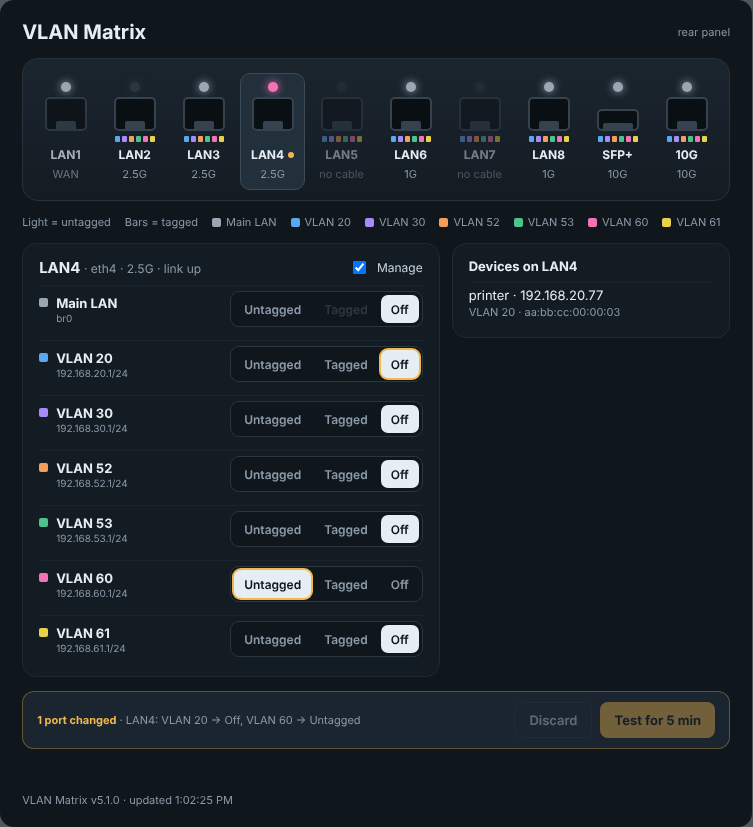

# VLAN Matrix for Asuswrt-Merlin

Choose **Untagged / Tagged / Off** for every VLAN on every LAN port of your ASUS router.
The stock ASUS VLAN page only offers *Default*, *Access* (one VLAN) or *Trunk* (all VLANs) per port.



* **Rear-panel view** – every port with its untagged network (light) and tagged networks (bars). Click a port to edit it.
* **Test first** – changes are applied at once and **revert automatically after 5 minutes** unless you press *Keep*.
  You cannot lock yourself out.
* **Persistent** – saved settings are re-applied at boot, every time the router rebuilds its network, and every 5 minutes.
* **Devices per port** – IP addresses, names and network of what is plugged in.
* **One place** – optionally replaces the ASUS port page, so ports are not configured in two places.
* Small: one shell script and one web page. No Entware. NVRAM is only touched by the optional *takeover*.

> **Built and tested on Asuswrt-Merlin 3006.102.9 on an RT-BE88U in router mode.**
> Other Merlin versions and models may work but are untested – see *Other models* and please report back.

## Requirements

* Asuswrt-Merlin **3006.102.9** (tested) – other 3006.102.x builds will most likely work
* Router mode (not AP / mesh node)
* JFFS custom scripts enabled, SSH access
* VLANs created on the ASUS *LAN → VLAN → Profile* page

## Install

1. Enable *Administration → System → Enable JFFS custom scripts and configs* and SSH.
2. Create your VLANs as usual on the ASUS page *LAN → VLAN → Profile*.
3. Log in with SSH and run:

```sh
curl -fsSL https://raw.githubusercontent.com/daffydk1/asuswrt-vlanmatrix/main/install.sh | sh -s install
```

4. Open **LAN → VLAN → VLAN Matrix** (press Ctrl+F5 once if the tab is missing).
5. Recommended – let VLAN Matrix replace the ASUS port page:

```sh
/jffs/addons/vlanmatrix/vm.sh takeover
```

   Your current ASUS port setup (trunk / access ports) is copied into VLAN Matrix, all ports are set to *Default* in ASUS
   and the network restarts once (~30 s). `vm.sh giveback` restores the ASUS settings.
   The ASUS *VLAN* tab stays visible next to *VLAN Matrix*. Ports ticked *Manage* in VLAN Matrix win: a change made to
   them on the ASUS page is undone at the next network restart, so use the ASUS page to look, or for unmanaged ports.

**Update:** `sh /jffs/addons/vlanmatrix/install.sh update` &nbsp; **Uninstall:** `sh /jffs/addons/vlanmatrix/install.sh uninstall`
(gives the ports back to ASUS and keeps a copy of your setup in `/jffs/addons/vlanmatrix-ports.conf.saved`).

## Use

1. Click a port on the rear panel.
2. Tick **Manage**. The port's current state is copied in.
3. Choose Untagged / Tagged / Off per network. Only one network can be untagged on a port.
4. **Test for 5 min**, check that everything works, then **Keep** – or do nothing and it reverts by itself.

**Networks.** Below the editor you can add a VLAN network (VLAN ID, optional isolation) or delete one. VLAN Matrix uses the
ASUS VLAN Profiles page for this in the background, so subnet and DHCP are set up exactly as ASUS would
(192.168.&lt;VLAN ID&gt;.1/24 for IDs up to 254). The router restarts its network and Wi-Fi (about a minute). Wi-Fi names
(SSIDs) for a network are still set on the ASUS *VLAN Profiles* tab.

When a port's untagged network changes, VLAN Matrix switches the port off for 3 seconds, so the device on it asks for a new
IP address straight away (no need to unplug the cable).

**Untagged or tagged?** A normal device (PC, phone, printer, TV) needs its network as **Untagged**.
**Tagged** is for VLAN-aware equipment: managed switches, access points with several SSIDs, Proxmox/NAS hosts with VLAN interfaces.

| Manage | Meaning |
|---|---|
| ticked | VLAN Matrix keeps the port exactly as set – at boot, after ASUS network restarts and every 5 minutes. |
| not ticked | VLAN Matrix does not touch the port; it follows ASUS (after *takeover*: Main untagged, all VLANs tagged). |

A port you stop managing keeps its state until the next reboot or network restart. A new VLAN shows up as *Tagged* on all
ports (the ASUS default) until you set it.

## Command line

```sh
vm=/jffs/addons/vlanmatrix/vm.sh
$vm status                                  # current state as JSON
$vm test "eth3:main=U,20=T,30=O"            # try a setup (reverts after 5 min)
$vm confirm                                 # keep it
$vm rollback                                # undo now
$vm takeover | giveback                     # replace the ASUS port page / give it back
```

Saved setup: `/jffs/addons/vlanmatrix/ports.conf`, one line per managed port, e.g. `eth3 main=U 20=T 30=O`.
Log: `/jffs/addons/vlanmatrix/vlanmatrix.log`.

## How it works

ASUS creates one Linux bridge per VLAN (e.g. VLAN 20 → `br55`) and VLAN sub-interfaces (`eth3.20`) in it.

| Choice   | What VLAN Matrix does                                        |
|----------|--------------------------------------------------------------|
| Untagged | the port itself (`eth3`) becomes a member of the VLAN bridge |
| Tagged   | `eth3.20` is created if needed and joined to the bridge      |
| Off      | neither is a member                                          |

Only `brctl`, `vconfig`/`ip` and `ethctl` (to bounce the link) are used. Bridges are discovered from the interfaces ASUS
creates, so no VLAN IDs, bridge names or MAC addresses are hard-coded.

Notes for Broadcom routers:
* VLAN sub-interfaces are never deleted, only detached – a deleted one often cannot be re-created until reboot.
* `ip link set down` does not switch the physical port off; `ethctl <if> phy-power down/up` does.
* The hardware flow cache is flushed (`fcctl flush`) after changes.

## Other models

Ports are mapped per model in `vm.sh` (`port_map`). For another model create `/jffs/addons/vlanmatrix/ports.map`,
one line per port: label, interface and optionally `sfp`:

```
LAN1 eth1
LAN2 eth2
SFP+ eth9 sfp
```

A port in use as WAN is detected and never managed. Find your interfaces with `brctl show` and by plugging a cable in
(`cat /sys/class/net/eth*/carrier`). Please open an issue or pull request with a working map for your model.

RT-BE88U map (names as on the ASUS VLAN page): LAN1 (2.5G WAN/LAN) = eth1, LAN2–LAN4 (2.5G) = eth2–eth4,
LAN5–LAN8 (1G) = eth5–eth8, 10G SFP+ = eth9, 10G WAN/LAN = eth0.

## Safety

Use at your own risk. While testing, keep a second way into the router (Wi-Fi or another port) – the 5-minute
auto-revert is there for exactly that. A test never survives a reboot.

## License

MIT – see [LICENSE](LICENSE).
